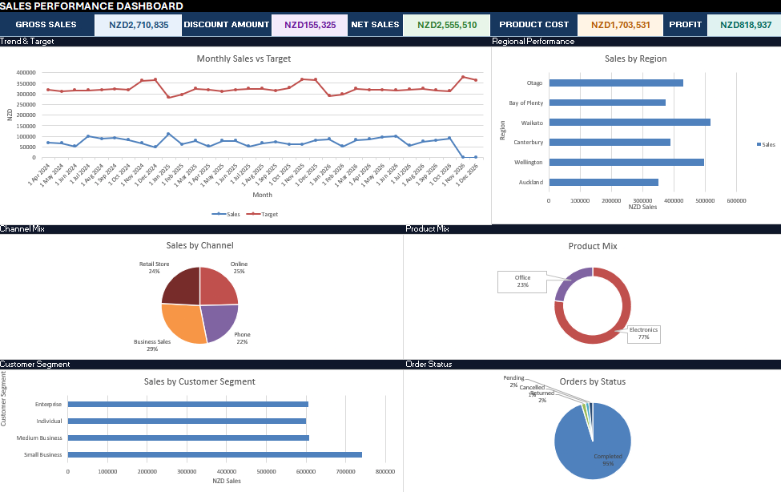

# Excel Sales Performance Dashboard

## Project Overview

This project showcases an interactive Sales Performance Dashboard developed using Microsoft Excel, with assistance from ChatGPT.

The dashboard provides a clear overview of business sales performance through key performance indicators (KPIs), monthly sales trends, regional analysis, sales channels, product categories, customer segments and order status.

The goal is to transform sales data into meaningful business insights that support better decision-making.

## Dashboard Preview

## Key Performance Indicators (KPIs)

| KPI | Value |
|---|---:|
| Gross Sales | NZD 2,710,835 |
| Discount Amount | NZD 155,325 |
| Net Sales | NZD 2,555,510 |
| Product Cost | NZD 1,703,531 |
| Profit | NZD 818,937 |

## Dashboard Features

### 1. Sales Trends and Targets
- Monthly sales performance compared with targets.
- Identifies sales trends over time.
- Helps monitor business performance.

### 2. Regional Performance
- Compares sales across six New Zealand regions.
- Identifies high-performing and low-performing regions.

### 3. Sales Channel Analysis
- Online sales
- Phone sales
- Business sales
- Retail store sales

### 4. Product Analysis
- Electronics
- Office products
- Product category contribution to total sales.

### 5. Customer Segmentation
- Enterprise
- Individual
- Medium Business
- Small Business

### 6. Order Status Analysis
- Completed orders
- Pending orders
- Cancelled orders
- Returned orders

## Tools and Technologies

- Microsoft Excel
- Excel Charts and Data Visualisation
- KPI Reporting
- Dashboard Design
- ChatGPT (AI-assisted development)

## Business Insights

The dashboard helps answer important business questions:

- How are actual sales performing against monthly targets?
- Which regions generate the highest sales?
- Which sales channels contribute most to revenue?
- Which product categories drive sales?
- Which customer segments contribute most to revenue?
- What percentage of orders are completed?

## Project Files

- `Sales_Performance_Dashboard.xlsx` – Excel dashboard workbook.
- `images/sales-performance-dashboard.png` – Dashboard screenshot.

## What I Learned

- Designing business-focused Excel dashboards.
- Presenting KPIs and sales metrics.
- Analysing sales performance across different dimensions.
- Using visualisations to communicate business information.
- Exploring AI tools such as ChatGPT to support dashboard development.

---

**Author:** Ramu Valliappan

**Domain:** Data Analytics | Business Intelligence
